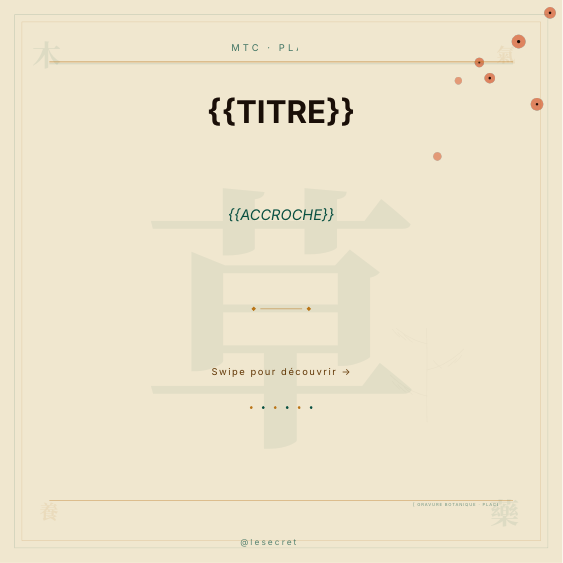
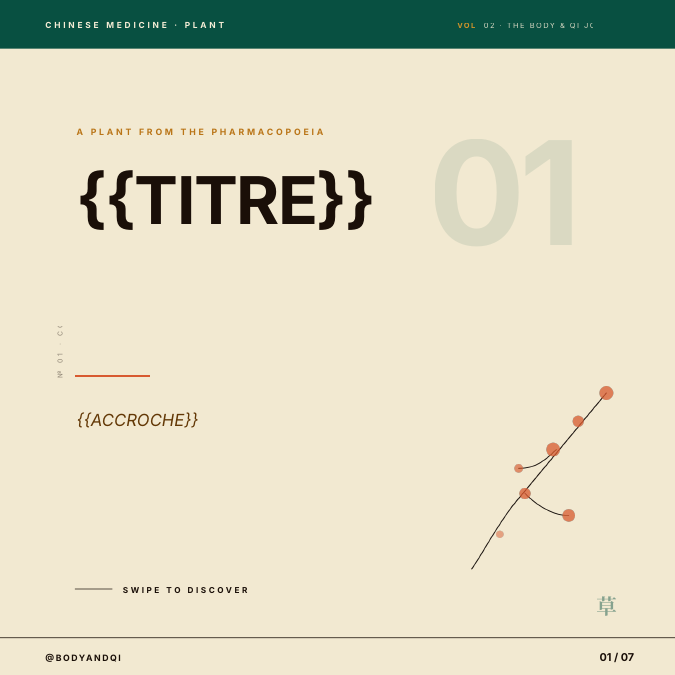

# TCM content pipeline

An automated workflow that produces bilingual (French and English) educational content on Traditional Chinese Medicine, every morning, without manual work.

I practise TCM daily and wanted to share what I learned in Shanghai in a format people actually read. Writing each post by hand did not scale, so I built this pipeline.

## How it works

```
Schedule (8:00) → Claude (writes the carousel) → Google Sheets (stores it for review) → Gmail (notifies me)
```

1. **Schedule trigger**: runs every morning at 8:00.
2. **Claude**: writes a full 8-slide Instagram carousel on a TCM topic (hook, three causes, signs, three foods, one ritual, call to action), plus captions and hashtags in French and English. The prompt sets the tone: serious but accessible, short sentences, never a medical promise.
3. **Google Sheets**: appends the content with the date and topic, so I can review and validate it before publishing.
4. **Gmail**: sends me a notification that new content is ready.

The workflow file is in [`tcm-content-pipeline.json`](tcm-content-pipeline.json). Credentials, the Google Sheet ID and my email address have been removed.

## Design

The text is dropped into a library of carousel templates I designed, in French and English (one plant per post, habits, myths, seasons, comparisons).

| French | English |
|---|---|
|  |  |

## Guides

- [10 Chinese herbs that belong in your life](10-chinese-herbs-guide.html)
- [5 TCM ingredients that change everything](5-tcm-ingredients-guide.pdf)

## Run it yourself

1. Import `tcm-content-pipeline.json` into n8n.
2. Connect your Anthropic, Google Sheets and Gmail credentials.
3. Replace `YOUR_GOOGLE_SHEET_ID` and `you@example.com` with your own.

Educational content only, not medical advice.
